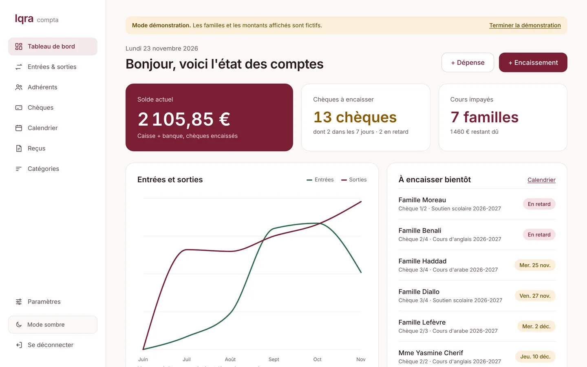
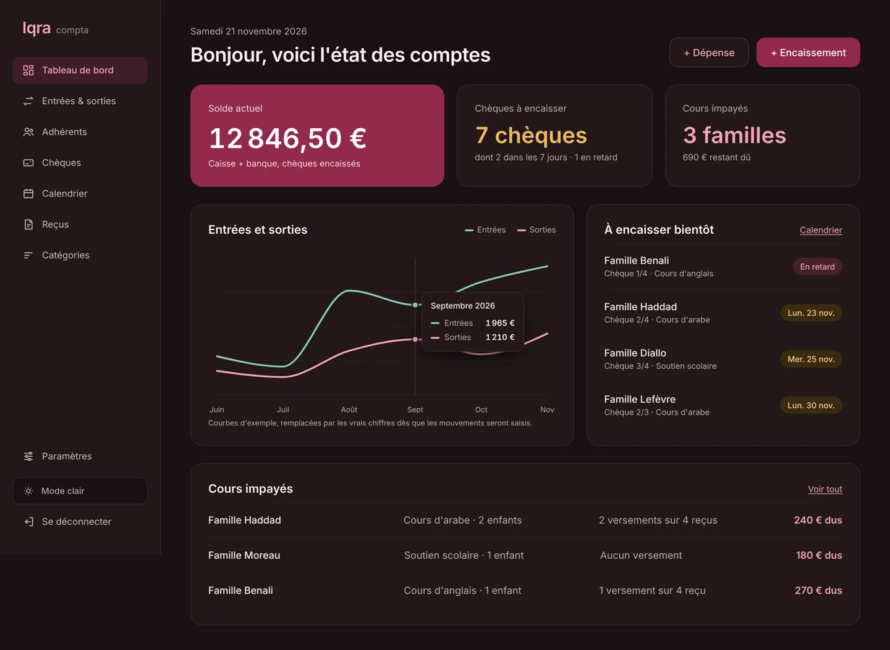
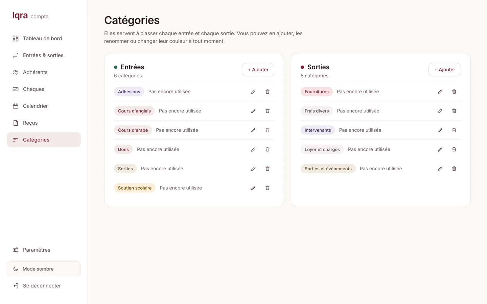
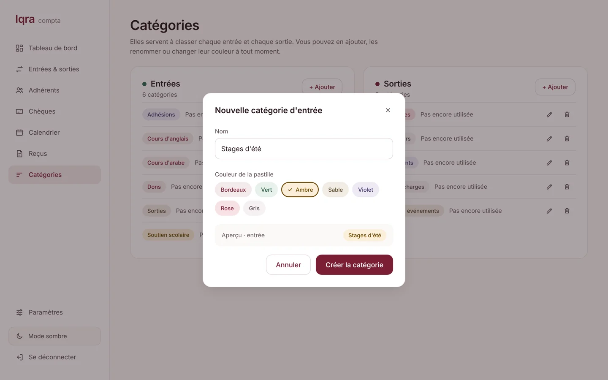
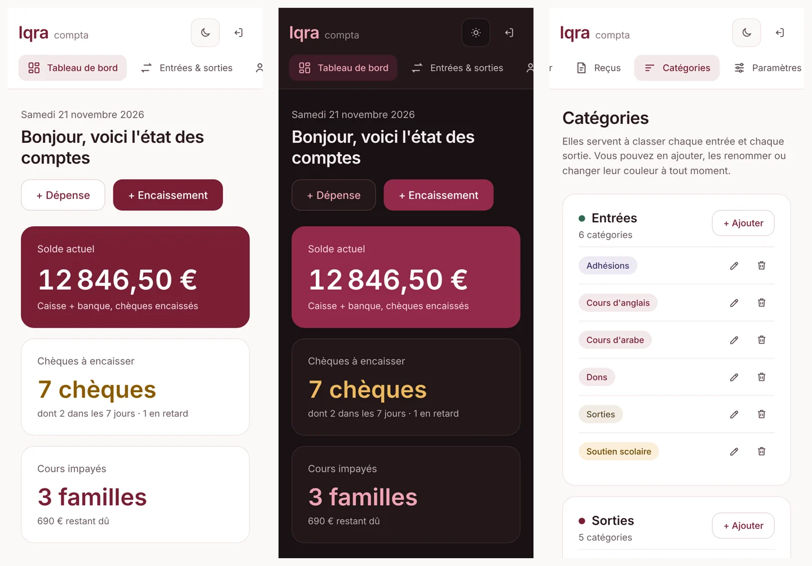

# Iqra Compta

Application web de comptabilité pour l'association Iqra (cours d'anglais, d'arabe,
soutien scolaire, sorties et événements). Un seul compte : la trésorière.

Le brief d'origine et les maquettes validées sont dans [`docs/design/`](docs/design/).

## Aperçu

| Tableau de bord | Mode sombre |
| --- | --- |
|  |  |

| Catégories | Ajout d'une catégorie |
| --- | --- |
|  |  |

Sur téléphone, le menu passe en haut :



## Où en est le projet

| Étape | Contenu | État |
| --- | --- | --- |
| 1 | Socle : Next.js, thème clair/sombre, connexion, menu, animations | ✅ fait |
| 2 | Catégories (ajout, modification, suppression ou archivage) | ✅ fait |
| 3 | Adhérents et fiche adhérent | à venir |
| 4 | Encaissements, dépenses, échéancier de chèques | à venir |
| 5 | Tableau de bord branché sur les vraies données | à venir (la page existe, avec des données d'exemple) |
| 6 | Reçus PDF | à venir |
| 7 | Calendrier | à venir |
| 8 | Rappels par email | à venir |

## Projet en ligne

- **Vercel** : projet `iqra-compta`, relié à ce dépôt (chaque envoi sur la branche
  de production redéploie). Exécution à Paris, versions d'essai désactivées.
- **Supabase** : projet `iqra-compta`, région Paris, relié à Vercel par l'onglet
  *Storage* (les adresses de connexion sont posées automatiquement, pour la
  production uniquement).
- **Compte autorisé** : un seul compte Supabase peut entrer, celui dont
  l'identifiant (*User UID*) est dans la variable Vercel `AUTH_ALLOWED_USER_ID`.
  Tout autre compte, même avec un mot de passe juste, reçoit le même message
  « Email ou mot de passe incorrect ».
- **Si le compte est supprimé puis recréé**, son identifiant change : il faut
  remettre le nouveau *User UID* dans `AUTH_ALLOWED_USER_ID` (Vercel → *Settings →
  Environment Variables*), puis *Deployments → Redeploy*.
- **En cas de refus inexpliqué** : Vercel → *Logs* affiche le motif réel (lignes
  `[auth]`), et Supabase → *Logs → Auth* montre si le mot de passe a été accepté.

## Mettre en ligne (Vercel + Supabase)

Vous n'avez rien à installer sur votre ordinateur : tout se fait dans le navigateur.

### 1. Supabase (base de données et connexion)

1. Créez un projet sur [supabase.com](https://supabase.com). Choisissez une région
   européenne, idéalement **West EU (Paris)** : les données restent en France.
   Notez le mot de passe de la base, il sert à l'étape 5.
2. **Compte de la trésorière** : *Authentication → Users → Add user* (email + mot de
   passe long et unique). Copiez son identifiant (colonne *UID*) : c'est la valeur
   de `AUTH_ALLOWED_USER_ID`.
3. **Fermez les inscriptions** : *Authentication → Sign In / Providers →* décochez
   *Allow new users to sign up*.
4. **Clés** : *Project Settings → API* → l'URL du projet (`NEXT_PUBLIC_SUPABASE_URL`)
   et la clé *publishable* (`NEXT_PUBLIC_SUPABASE_PUBLISHABLE_KEY`). Ne copiez
   jamais la clé *secret* / *service_role* : l'application n'en a pas besoin.
5. **Base de données** : le plus simple est de relier la base au projet depuis
   Vercel (*Storage →* la base *→ Connect Project*, en ne cochant que
   **Production**) : Vercel pose alors lui-même les adresses de connexion, sans mot
   de passe à copier. Sinon, bouton *Connect → ORMs → Prisma* dans Supabase → les
   deux adresses proposées (`DATABASE_URL` et `DIRECT_URL`), en y remplaçant
   `[YOUR-PASSWORD]`.
6. **Certificat de la base** : *Database → Settings → SSL Configuration →*
   *Download certificate*. Collez le contenu du fichier dans `DATABASE_CA_CERT`
   (ce n'est pas un secret). L'application vérifie toujours l'identité de la
   base ; ce certificat est nécessaire si elle n'est pas reconnue par les
   autorités habituelles (la connexion est alors refusée, jamais dégradée). Au
   même endroit, activez *Enforce SSL on incoming connections* : Supabase
   refusera alors toute connexion non chiffrée.
7. **Coupez l'API publique** : *Integrations → Data API →* désactivez *Enable Data
   API*. L'application ne l'utilise pas ; elle est de toute façon verrouillée par
   les migrations, mais une porte fermée vaut mieux.
8. **Supprimez tout autre compte** dans *Authentication → Users* : seul celui de la
   trésorière doit exister.

### 2. Vercel (hébergement)

1. Sur [vercel.com](https://vercel.com), *Add New → Project* et importez ce dépôt GitHub.
2. Dans *Environment Variables*, ajoutez les six variables ci-dessus :
   `NEXT_PUBLIC_SUPABASE_URL`, `NEXT_PUBLIC_SUPABASE_PUBLISHABLE_KEY`,
   `AUTH_ALLOWED_USER_ID`, `DATABASE_URL`, `DIRECT_URL`, `DATABASE_CA_CERT`.
   Pour `AUTH_ALLOWED_USER_ID`, `DATABASE_URL` et `DIRECT_URL`, ne cochez que
   **Production** : les versions d'essai (« Preview ») n'ont ainsi aucun accès aux
   vraies données.
3. Cliquez sur *Deploy*. À chaque mise en ligne, Vercel lance `npm run vercel-build`
   (réglé dans `vercel.json`, comme la région d'exécution : Paris). Pour la
   production uniquement : contrôle de la configuration, création ou mise à jour
   des tables, **contrôle de sécurité de la base** (le déploiement est refusé si
   la liaison n'est pas chiffrée ou si une table n'est pas verrouillée), puis
   construction du site. Une version d'essai ne touche jamais à la base.
4. Ouvrez l'adresse fournie par Vercel et connectez-vous.

Si une variable manque, l'application affiche un message d'erreur explicite et
ne sert aucune page : elle ne s'ouvre jamais « par défaut ».

> Ces étapes n'ont pas encore été déroulées sur un vrai projet Supabase ni sur
> Vercel : tout a été vérifié ici avec un serveur d'authentification simulé et un
> Postgres local. Dites-moi si un intitulé de menu a changé ou si une étape bloque.

## Travailler en local (développeurs)

Il faut [Node.js](https://nodejs.org) 20 ou plus récent et une base Postgres
(celle de Supabase, ou un Postgres local).

```bash
npm install
cp .env.example .env.local   # puis remplissez les valeurs
npm run db:deploy            # crée les tables et les catégories de départ
npm run dev                  # http://localhost:3000
```

**Sans compte Supabase** : mettez seulement `DATABASE_URL` (Postgres local) et
`AUTH_DEMO_MODE=1` dans `.env.development.local`. Le mode démo ouvre l'application
sans mot de passe ; il n'existe qu'en développement et est ignoré en production.

## Commandes

| Commande | Rôle |
| --- | --- |
| `npm run dev` | Lance l'application en développement |
| `npm run build` puis `npm start` | Version de production |
| `npm run typecheck` | Vérifie les types TypeScript |
| `npm run lint` | Vérifie le code, dont les garde-fous de sécurité |
| `npm run db:migrate` | Crée et applique une migration (développement) |
| `npm run db:deploy` | Applique les migrations (production) |
| `npm run db:check` | Vérifie que la base est verrouillée (RLS, droits) |
| `npm run db:studio` | Ouvre un explorateur de la base |
| `npm run test:e2e` | Tests complets dans un vrai navigateur (voir `tests/e2e/run.sh`) |

## Organisation du code

```
docs/design/            Brief et maquettes d'origine
prisma/                 Modèle de données et migrations
scripts/                Contrôle de sécurité de la base
tests/e2e/              Tests de bout en bout (navigateur piloté)
src/proxy.ts            Protège toutes les pages (redirige vers /connexion)
src/app/connexion/      Page de connexion
src/app/(app)/          Pages de l'application (menu + contenu)
src/components/shell/   Menu, bascule clair/sombre, déconnexion
src/components/ui/      Boutons, cartes, pastilles, blocs d'attente
src/components/motion/  Compteur animé
src/lib/auth/           Vérification de la session
src/lib/data/           Lecture des données (une fonction = une vérification de session)
src/lib/format.ts       Euros et dates en français
src/app/globals.css     Couleurs (clair et sombre) et animations
```

## Style et animations

- Couleurs, rayons et courbes d'animation sont des variables dans
  `src/app/globals.css` ; le thème sombre redéfinit les mêmes variables.
- Les entrées de page (cartes puis lignes, en cascade) sont en CSS pur :
  `animate-rise` + `stagger-1`, `stagger-2`…
- La bibliothèque Motion sert pour ce que le CSS ne sait pas faire : la pastille du
  menu qui glisse d'une entrée à l'autre, les compteurs qui montent, les lignes qui
  s'insèrent ou disparaissent dans une liste.
- Les fenêtres (ajout, modification, confirmation) s'ouvrent et se ferment en douceur.
- Le passage clair/sombre est un fondu enchaîné de toute la page.
- Si l'appareil demande « moins de mouvement », tout s'affiche sans animation.

## Sécurité

Les données sont confidentielles : l'application est construite pour refuser par
défaut, avec plusieurs verrous indépendants.

**Qui peut entrer**
- Toutes les adresses passent par `src/proxy.ts`, premier filtre : sans session
  valide, retour à la connexion. Un seul compte est accepté
  (`AUTH_ALLOWED_USER_ID`), même si d'autres comptes existaient dans Supabase.
- La vraie protection des données est `requireUser` : chaque lecture et chaque
  modification revérifie la session auprès de Supabase. Un cookie copié ne
  fonctionne plus après déconnexion. `npm run lint` refuse toute action serveur
  qui ne commence pas par cette vérification.
- Le cookie de session est `HttpOnly` (illisible par JavaScript), `Secure`,
  `SameSite=Lax`, et disparaît à la fermeture du navigateur. Une session dure
  **12 heures au maximum**. Sur un ordinateur partagé, cliquez sur « Se déconnecter ».
- **Force brute** : après 5 mots de passe faux en 15 minutes depuis une même
  adresse, cette adresse est bloquée ; après 20 échecs sur un même email, toutes
  adresses confondues, l'email est bloqué pendant la fenêtre.
- Tout refus de connexion donne exactement la même réponse, que l'email soit
  inconnu, le mot de passe faux, ou le compte non autorisé.
- Configuration incomplète = application bloquée (erreur 503), jamais ouverte.

**Injection SQL**
- La base n'est interrogée que par des requêtes Prisma, toujours paramétrées :
  ce que saisit l'utilisatrice n'est jamais collé dans une requête.
- `npm run lint` refuse les rares fonctions qui le permettraient
  (`$queryRawUnsafe`, `$executeRawUnsafe`, `Prisma.raw`).
- Tout ce qui arrive du navigateur est validé côté serveur (zod) avant usage.
- Testé : un nom comme `x'); DROP TABLE categories;--` est enregistré tel quel,
  comme un simple texte.

**Injection de code dans les pages (XSS)**
- React échappe tout texte affiché ; `dangerouslySetInnerHTML` et `eval` sont
  interdits par le lint.
- En-tête `Content-Security-Policy` : le navigateur ne charge de scripts, styles,
  polices et formulaires que depuis l'application elle-même, et refuse de
  l'afficher dans une autre page (anti-détournement de clic).
- Autres en-têtes : `X-Content-Type-Options`, `Referrer-Policy`,
  `Permissions-Policy`, `Strict-Transport-Security` (HTTPS obligatoire).

**Base de données**
- La liaison entre l'application et la base est **chiffrée (TLS) et le serveur est
  authentifié** par son certificat : si l'identité du serveur ne peut pas être
  prouvée, l'application refuse de se connecter plutôt que d'envoyer des données
  en clair.
- RLS activé sur toutes les tables, sans aucune règle : l'API publique de Supabase
  ne peut rien lire ni écrire. Les rôles de cette API n'ont en plus aucun droit,
  ni sur les tables ni sur les fonctions.
- `npm run db:check` le vérifie et bloque la mise en ligne en cas d'oubli.
- Contraintes dans la base : montants positifs, 4 versements au plus, etc.
- Une catégorie déjà utilisée n'est jamais supprimée, seulement archivée.

**Ce qui dépend de vous**
- Un mot de passe long et unique pour le compte de la trésorière et pour Supabase,
  Vercel et GitHub ; activez la double authentification sur ces trois services.
- Ne partagez jamais le contenu de `.env.local` ni les variables Vercel.
- Gardez le dépôt GitHub privé.

**Limites connues**
- Pas de double authentification à la connexion de l'application elle-même
  (possible avec Supabase, à ajouter si vous le souhaitez).
- Le blocage après 20 échecs sur un email protège contre une attaque venant de
  nombreuses adresses, mais quelqu'un qui connaît l'email de la trésorière peut
  ainsi l'empêcher de se connecter tant qu'il s'acharne. Il ne peut pas entrer.
- Un nom écrit avec des lettres d'un autre alphabet qui se ressemblent (un « о »
  cyrillique dans « Dons ») est accepté comme un nom différent.
- La politique de contenu autorise les scripts « en ligne » de l'application
  (nécessaire à Next.js avec des pages pré-rendues) : elle bloque le chargement de
  scripts extérieurs, pas un script injecté dans la page. La protection contre
  ce cas repose sur l'échappement systématique par React.
