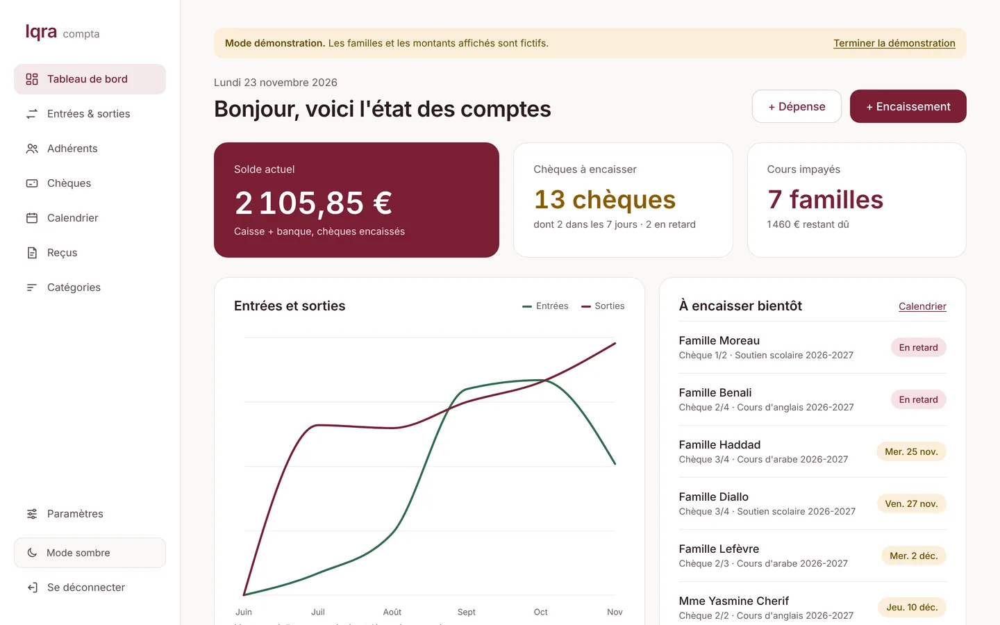
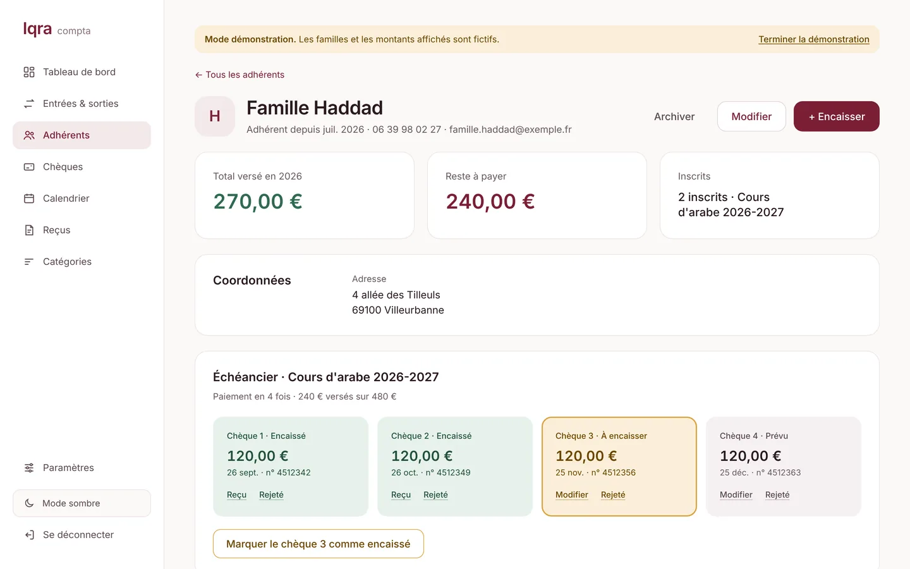
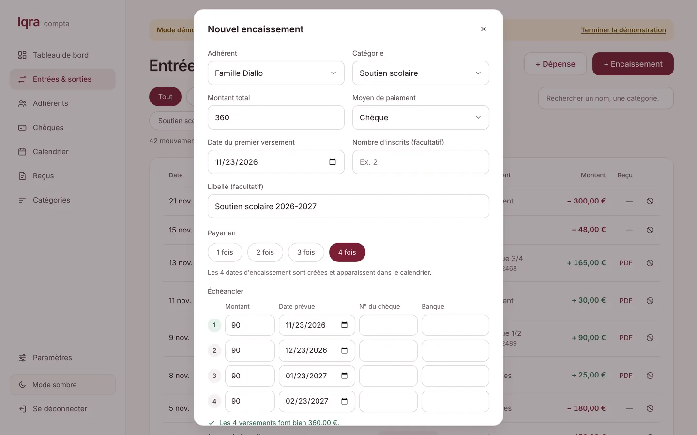
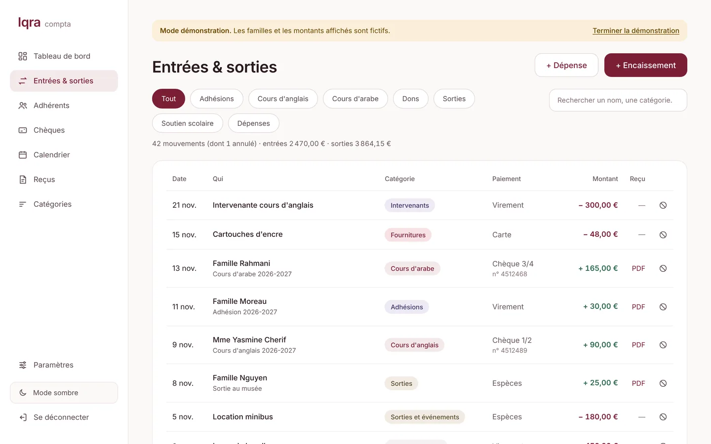
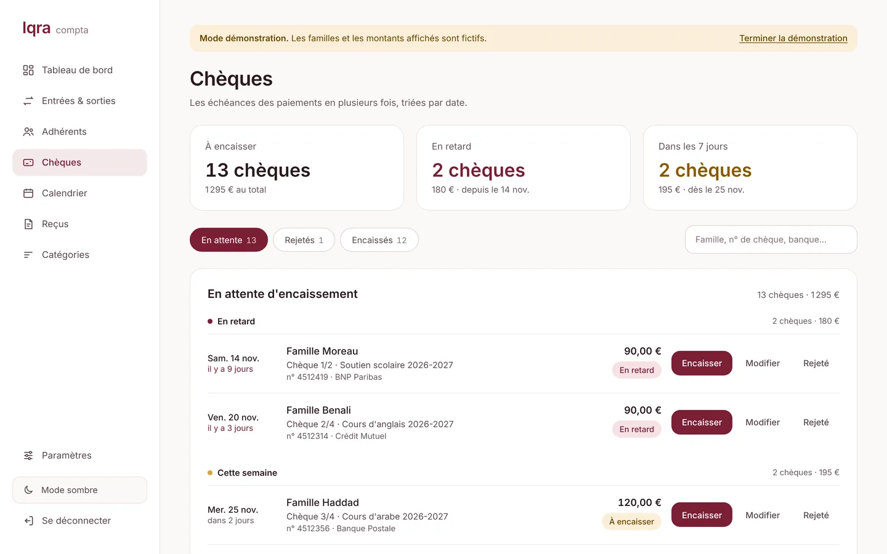
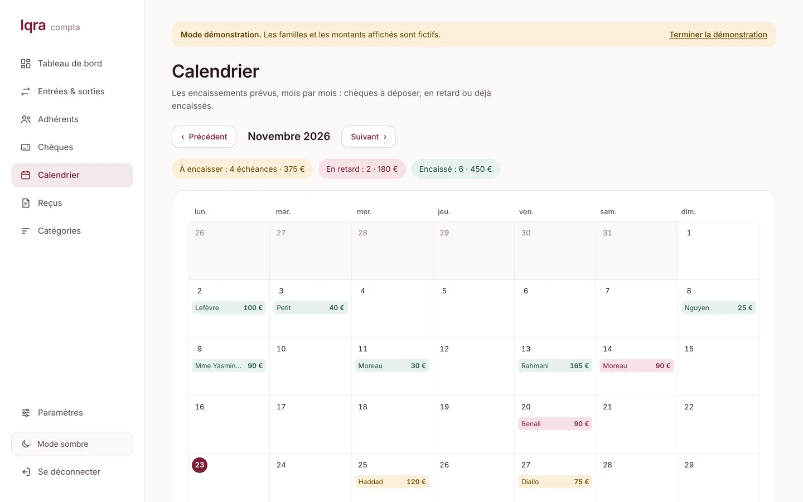
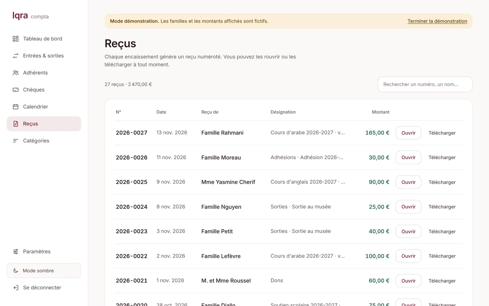
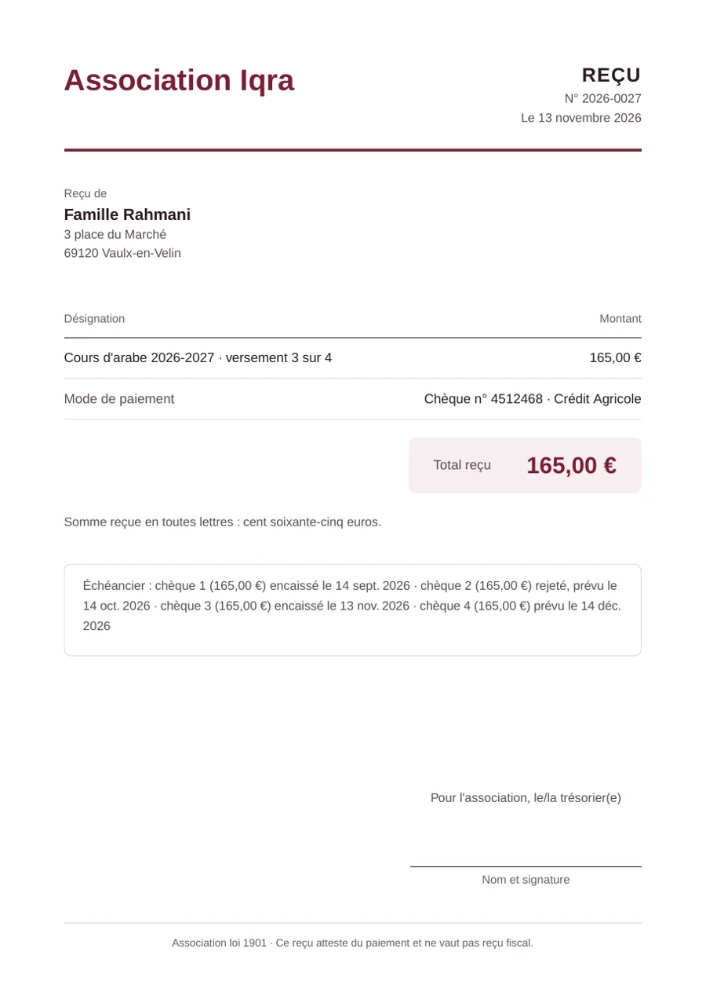
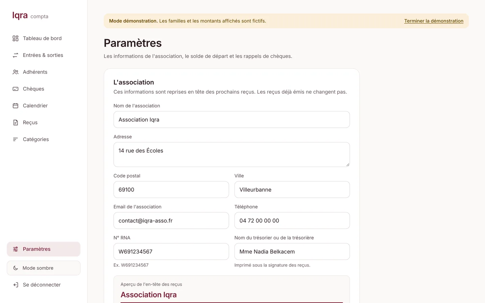
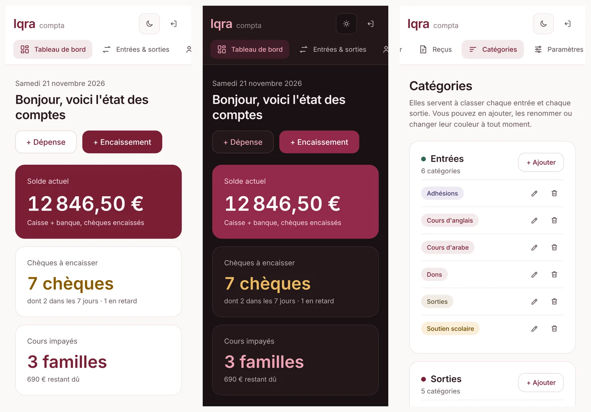

# Iqra Compta — tutoriel en mode démonstration

Ce tutoriel fait le tour de l'application avec des **données fictives** (11
familles inventées). Rien de ce que vous faites pendant la démonstration ne
compte pour de vrai : tout s'efface en un clic à la fin.

> Durée : 10 minutes environ. Une vidéo de la même visite existe
> (« iqra-tutoriel-ordinateur.mp4 » et « iqra-tutoriel-telephone.mp4 »).

## 1. Charger la démonstration

1. Connectez-vous, puis ouvrez **Paramètres** (en bas du menu).
2. Dans la carte **Démonstration**, cliquez sur **« Charger les données de
   démonstration »** (quelques secondes).
3. Un bandeau jaune **« Mode démonstration »** apparaît en haut de chaque page :
   il rappelle que les familles et les montants sont fictifs.

> Le chargement n'est possible que dans une application vide : il ne peut jamais
> se mélanger à de vraies données.

## 2. Le tableau de bord

- **Solde actuel** : solde de départ + argent encaissé − dépenses. Un chèque
  seulement *prévu* n'y entre pas.
- **Chèques à encaisser** : combien attendent, dont ceux des 7 prochains jours et
  ceux **en retard**.
- **Cours impayés** : les familles qui ont encore des versements à faire.
- La courbe montre les entrées et sorties des 6 derniers mois ; la liste
  « À encaisser bientôt » commence par les chèques en retard (badge rouge).

## 3. Les adhérents et la fiche famille

1. Menu **Adhérents** : chaque famille, ce qu'elle a versé cette année et ce
   qui reste à payer. La recherche trouve un nom, un téléphone ou un email.
2. Cliquez sur **Famille Haddad**. La fiche montre l'échéancier des chèques :
   - vert = **encaissé**, ambre encadré = **à encaisser** (dans les 7 jours),
     gris = **prévu**, rose = **rejeté** ou **en retard**.
3. Cliquez sur **« Marquer le chèque 3 comme encaissé »**, gardez la date du jour
   et validez : le montant entre dans le solde et **le reçu est créé**
   (bouton « Ouvrir le reçu (PDF) »).
4. Sous chaque chèque : *Modifier* (date, numéro, banque), *Rejeté* (chèque
   refusé par la banque), *Reçu*.

## 4. Enregistrer un encaissement en 4 fois

1. Menu **Entrées & sorties**, bouton **« + Encaissement »**.
2. Adhérent : tapez « Diallo » et choisissez la famille. Catégorie : *Soutien
   scolaire*. Montant total : **360**. Moyen : *Chèque*.
3. **Payer en : 4 fois**. Les 4 échéances (90 € par mois) s'affichent ; vous
   pouvez changer un montant, une date, ajouter le n° de chèque et la banque.
   Le total est vérifié en direct.
4. **« Enregistrer et générer le reçu »** : le 1er versement est encaissé avec
   son reçu, les 3 autres attendent leur date dans **Chèques** et le
   **Calendrier**.

Pour une **dépense** : bouton **« + Dépense »** (date, libellé, catégorie,
montant, moyen de paiement). Une erreur de saisie ? Le petit bouton au bout de
la ligne **annule** le mouvement : il reste visible, barré, mais sort du solde.

## 5. Les chèques et le calendrier

- **Chèques** : tout ce qui reste à encaisser, trié par date (en retard, cette
  semaine, plus tard), avec les onglets *Rejetés* et *Encaissés*.
- Un chèque rejeté se **remet à encaisser** avec la nouvelle date et le chèque de
  remplacement.

- **Calendrier** : le mois en un coup d'œil (couleurs = statuts), puis le détail
  jour par jour avec les mêmes boutons. *Précédent* / *Suivant* changent de mois.

## 6. Les reçus

- Chaque encaissement a son reçu, numéroté sans trou : `2026-0001`, `2026-0002`…
- **Ouvrir** affiche le PDF, **Télécharger** l'enregistre.
- Un reçu ne change plus après son émission. S'il correspond à un mouvement
  annulé, il porte la mention **ANNULÉ**.

## 7. Les paramètres

- **L'association** : nom, adresse, email, téléphone, n° RNA, nom du trésorier
  ou de la trésorière — repris sur les prochains reçus (aperçu en direct).
- **Solde de départ** : ce qu'il y avait en banque et en caisse au début.
- **Rappels de chèques** : l'adresse qui reçoit chaque matin la liste des chèques
  à déposer (voir « Rappels par email » dans le README).
- **Reçu fiscal pour les dons** : désactivé, en attente de l'association.

## 8. Terminer la démonstration

Quand vous êtes prête à commencer la vraie comptabilité :

1. **Paramètres → Démonstration → « Terminer la démonstration… »**.
2. Tapez **EFFACER** puis **« Tout effacer »**.

Tous les adhérents, mouvements, chèques et reçus sont effacés ; les catégories et
les informations de l'association sont conservées et la numérotation des reçus
repart à `0001`. Pensez ensuite à renseigner le **solde de départ** réel.

## Sur téléphone

Le menu passe en haut, les tableaux deviennent des listes : tout reste
utilisable, y compris l'encaissement d'un chèque.
